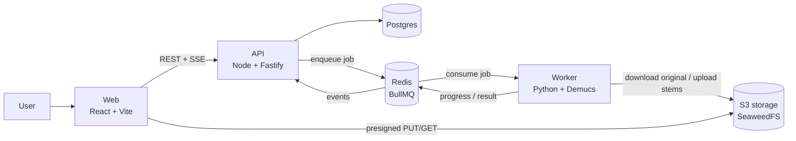
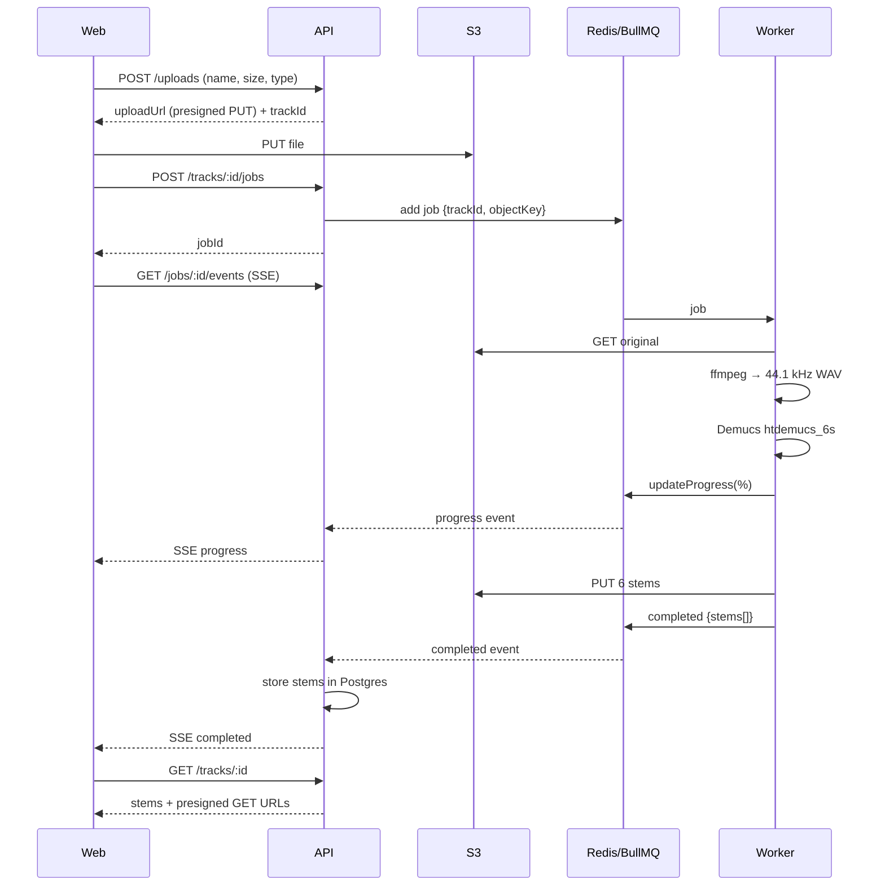

# 01 — Architecture

## Overview

## Components

| Component | Responsibility |
|-----------|----------------|
| **Web** | Upload, progress, mixer, library, downloads. Never touches the queue or the DB. |
| **API** | Validation, presigned URLs, job creation, status, SSE, history, auth. The single source of truth, in Postgres. |
| **Redis + BullMQ** | `separation` queue. Retries, backoff, progress, events. |
| **Worker** | Downloads the original, normalizes it with ffmpeg, runs Demucs, uploads the stems, reports progress. Stateless. |
| **Postgres** | Tracks, jobs, stems and users (phase 5). |
| **S3 storage** | Original files and stems. SeaweedFS locally, S3-compatible: moving to AWS S3 or Cloudflare R2 only changes environment variables. |

## Flow of a job

## Principles

- **Swappable worker.** The worker only knows the queue and S3. Moving to a GPU or a cloud provider does not affect the API or the web.
- **Files never pass through the API.** The web uploads to and downloads from S3 storage directly with presigned URLs. The API never streams audio (the ZIP download is the one exception).
- **Shared contracts.** The zod schemas in `packages/contracts` define API and job payloads. The worker validates the same contract with generated pydantic models.
- **Failures are expected.** Retries with backoff, idempotent jobs (same output key), timeouts based on duration.
- **Configuration by environment.** Nothing hardcoded; everything lives in `.env`.

Domain model in [06-domain.md](06-domain.md). Layers and dependency rules in [07-code-structure.md](07-code-structure.md).

## Expected performance (CPU)

Demucs on CPU takes roughly 1x to 3x the song's length, depending on the processor. A 4-minute song can take 4 to 12 minutes. That is why live progress and the queue are mandatory, not optional. Measured in phase 1: see the [spike results](spike-demucs.md).
