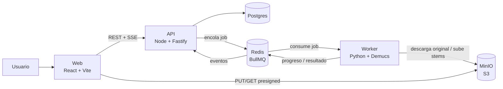
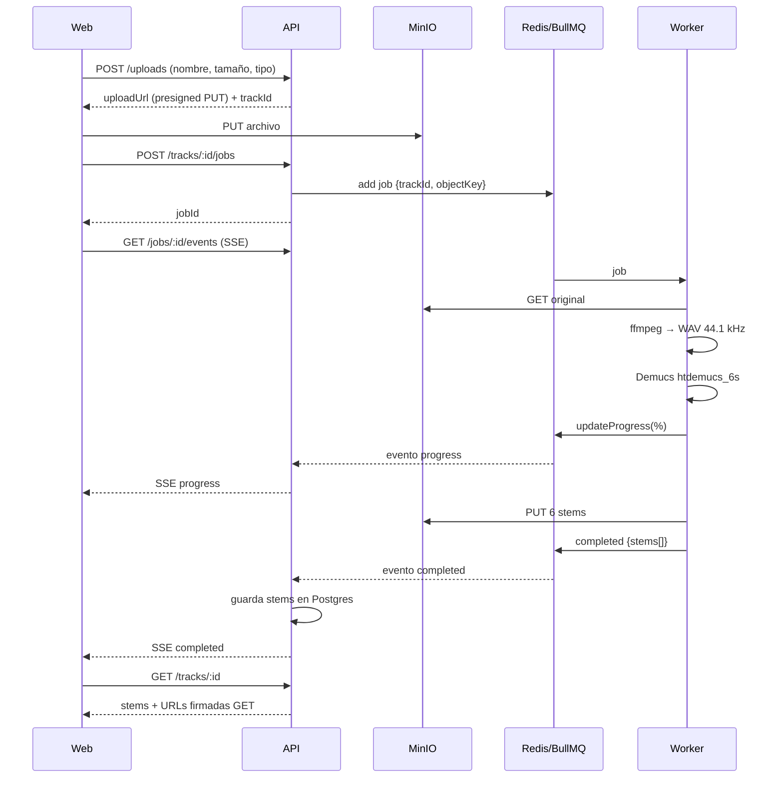

# 01 — Arquitectura

## Vista general

## Componentes

| Componente | Responsabilidad |
|------------|-----------------|
| **Web** | Subida, progreso, mixer, biblioteca, descargas. No toca la cola ni la DB. |
| **API** | Validación, URLs firmadas, creación de jobs, estado, SSE, historial, auth. Única fuente de verdad en Postgres. |
| **Redis + BullMQ** | Cola `separation`. Reintentos, backoff, progreso, eventos. |
| **Worker** | Descarga el original, normaliza con ffmpeg, ejecuta Demucs, sube stems, reporta progreso. Sin estado. |
| **Postgres** | Tracks, jobs, stems y (fase 5) usuarios. |
| **MinIO** | Archivos originales y stems. Compatible con S3: migrar a AWS S3 o Cloudflare R2 solo cambia variables de entorno. |

## Flujo de un trabajo

## Principios

- **Worker intercambiable.** El worker solo conoce la cola y S3. Cambiar a GPU o a un proveedor cloud no afecta API ni Web.
- **Archivos fuera de la API.** Web sube y descarga directo a MinIO con URLs firmadas. La API nunca transmite audio.
- **Contratos compartidos.** Los schemas zod en `packages/contracts` definen payloads de API y jobs. El worker valida el mismo contrato con modelos pydantic generados.
- **Fallos esperados.** Reintentos con backoff, jobs idempotentes (misma clave de salida), timeouts por duración.
- **Configuración por entorno.** Nada hardcodeado; todo en `.env`.

Modelo de dominio en [06-domain.md](06-domain.md). Capas y reglas de dependencia en [07-code-structure.md](07-code-structure.md).

## Rendimiento esperado (CPU)

Demucs en CPU tarda aproximadamente entre 1x y 3x la duración de la canción, según el procesador. Una canción de 4 minutos puede tardar entre 4 y 12 minutos. Por eso el progreso en vivo y la cola son obligatorios, no opcionales. Medir en fase 1.
