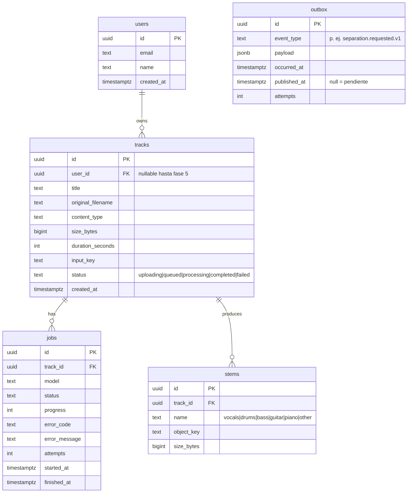

# 04 — Modelo de datos (borrador)

PostgreSQL con Drizzle ORM. Migraciones versionadas en `apps/api`.



## Claves en el storage S3

```
tracks/{trackId}/original.{ext}
tracks/{trackId}/stems/{name}.wav
```

## Notas

- `outbox`: se escribe en la misma transacción que el agregado; un relay publica las filas pendientes ([ADR 0014](adr/0014-transactional-outbox.md)).

- `users` llega en fase 5; Better Auth genera sus propias tablas (`session`, `account`, `verification`).
- Un track puede tener varios jobs (reintentos manuales, cambio de modelo futuro).
