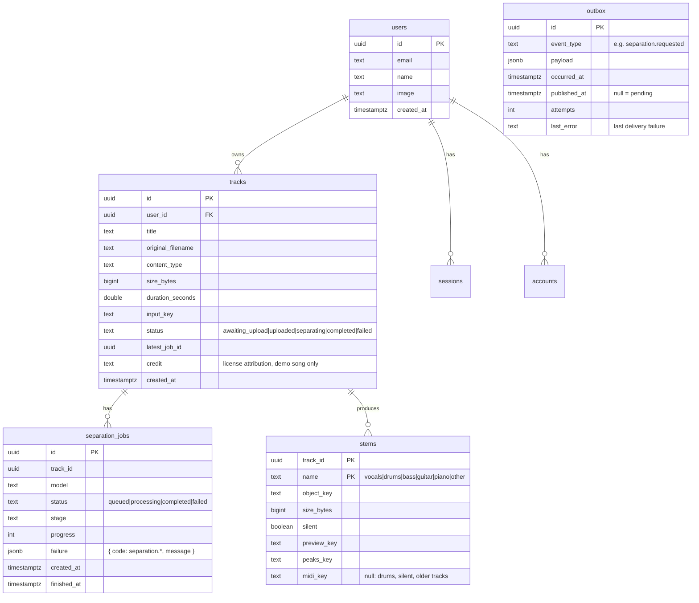

# 04 — Data model

PostgreSQL with Drizzle ORM. Versioned migrations in `apps/api/drizzle`, applied when the API starts.



## S3 storage keys

```
tracks/{trackId}/original.{ext}
tracks/{trackId}/stems/{name}.flac
tracks/{trackId}/stems/{name}.preview.mp3
tracks/{trackId}/stems/{name}.peaks.json
tracks/{trackId}/stems/{name}.mid       Basic Pitch transcription (ADR 0027)
demo/manifest.json                     shared demo song (ADR 0026)
demo/original.mp3, demo/stems/...
```

## Notes

- `outbox` is written in the same transaction as the aggregate; a relay publishes the pending rows ([ADR 0014](adr/0014-transactional-outbox.md)). Only `separation.requested` has an external route (the BullMQ job `separation.requested.v1`); the other events are marked as published.
- `separation_jobs.failure` holds a `separation.*` code; migration `0005_separation_failure_codes` renamed the codes stored before [ADR 0031](adr/0031-worker-separation-module.md).
- Better Auth owns `users`, `sessions`, `accounts` and `verifications`, all with UUID ids. `tracks.user_id` references `users.id` and cascades on delete ([ADR 0025](adr/0025-sessions-and-ownership.md)).
- A track can have several jobs (manual retries, a different model in the future); `latest_job_id` points at the current one.
- Demo tracks point at the shared files under `demo/`; deleting one never touches them.
