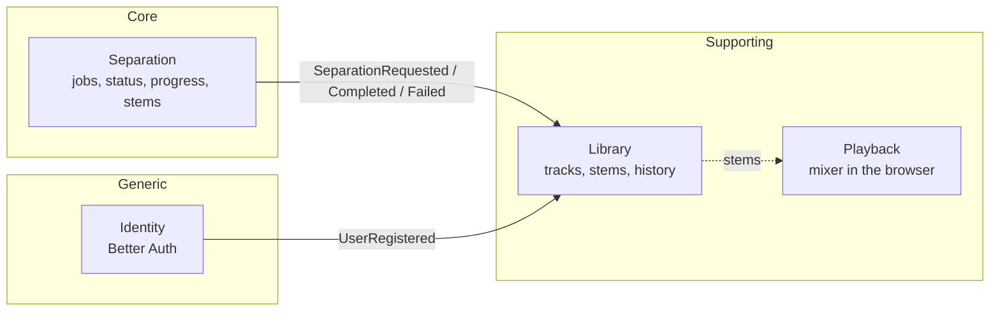
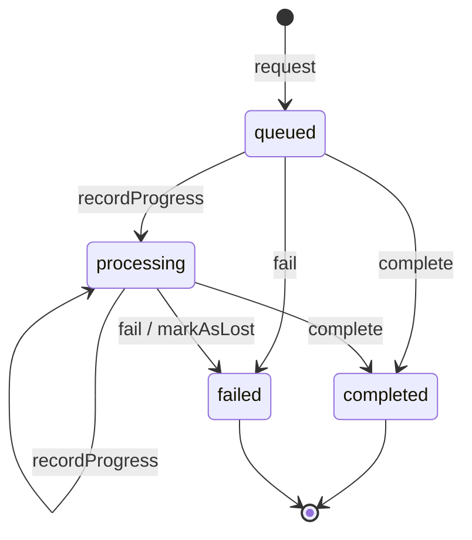

# 06 — Domain (DDD)

## Ubiquitous language

| Term | Meaning |
|------|---------|
| **Track** | A song uploaded by the user. It has an original file and, once separated, stems. |
| **Source media** | The original file (audio or video) exactly as the user uploaded it. |
| **Stem** | One instrument's isolated track: `vocals`, `drums`, `bass`, `guitar`, `piano`, `other`. |
| **Separation job** | One run of a track's separation with a given model. |
| **Separator** | The engine that splits stems (Demucs today). |
| **Stage** | Phase of a running job: `downloading`, `normalizing`, `separating`, `uploading`. |
| **Mix** | Mixer state in the browser: volume, mute and solo per stem. |
| **Transcription** | The notes of a pitched stem as a MIDI file ([ADR 0027](adr/0027-midi-transcription.md)). |
| **Demo song** | A pre-separated, licensed song every new user receives ([ADR 0026](adr/0026-demo-song-and-cleanup.md)). |

This vocabulary is used the same way in code, docs and conversations with the client.

## Bounded contexts

| Context | Type | Lives in |
|---------|------|----------|
| Separation | Core | API `modules/separation`, the worker's `modules/separation`, the web's `modules/separation` |
| Library | Supporting | API `modules/library`, the web's `modules/track` |
| Playback | Supporting | The web's `modules/mixer` |
| Identity | Generic | API `modules/identity` (Better Auth), the web's `modules/session` |

The API also has two technical modules, `outbox` (relays events to the queue) and `health`. Storage is not a context: each module that needs files has its own `StorageRepository` interface and an S3 implementation.

Modules reach each other only through another module's `domain/` or its `application/factory.ts`. Separation depends on the library's domain (`Track`, `TrackDuration`, `StemList`); the library never depends on separation. Inside the API, contexts react to each other through domain events; between processes they use the versioned messages in `packages/contracts`.

## Aggregates

### Library · `Track`

- Root: `Track` (`TrackId`, owner `UserId`, `TrackTitle`, `OriginalFilename`, `MediaType`, `FileSize`, input `ObjectKey`, `TrackStatus`, `TrackDuration?`, latest `JobId?`, `StemList`, `Credit?`, `CreatedAt`).
- Status: `awaiting_upload` → `separating` → `completed` or `failed`. A track that is not separating and not completed can start a new separation. `uploaded` is still a valid status, but no transition sets it today.
- Invariants:
  - The upload fits the size limit (`track.file_too_large`) and is an audio or video type (`track.unsupported_media_type`).
  - A track has at most one stem per `StemName`; stems are attached only when a separation completes.
  - A track cannot start a separation or be deleted while it is separating (`track.busy`); stems can be downloaded only once it is completed (`track.stems_not_ready`).
  - Only the outcome of its latest job changes it; late or repeated outcomes are ignored.
  - Only its owner can see or change it; for anyone else it does not exist ([ADR 0025](adr/0025-sessions-and-ownership.md)).

### Separation · `SeparationJob`

- Root: `SeparationJob` (`JobId`, `TrackId`, `ModelName`, `JobStatus`, `Stage?`, `Progress`, `JobFailure?`, `CreatedAt`, `FinishedAt?`, recorded `DomainEventList`).
- State machine:

- Invariants:
  - BullMQ retries happen inside `processing`: a failed attempt with retries left changes nothing ([ADR 0029](adr/0029-separation-jobs-and-outbox-modules.md)).
  - `QueueJobState.applyTo(job)` decides the transition for each queue state (pending, active, completed, failed, missing), for live events and for startup reconciliation alike.
  - Progress after the job finished, or a repeated outcome, is a no-op; a contradictory outcome (completing a failed job) throws `job.invalid_transition`.
  - A job that the worker had started and the queue no longer knows is failed as lost (`separation.failed`).
  - A job belongs to whoever owns its track.

### Worker · `SeparationTask`

The worker belongs to the Separation context, but its model is its own ([ADR 0031](adr/0031-worker-separation-module.md)): `SeparationTask` (what to split and where to put it) builds a `SeparationOutcome` with a `StemList`. `AudioDuration` enforces the length limit (`separation.duration_exceeded`), `RelativeLoudness` decides which stems are silent, and `SeparatedStem.should_be_transcribed()` decides which stems get MIDI. It knows nothing about tracks, users or job states.

### Web

The browser has its own small model of the same language ([ADR 0032](adr/0032-web-modules-hooks-and-components.md)): `TrackSummary.canBeDeleted()`, `Track.isReady()`, `UploadCandidate` (type and size limit before uploading), `Job.activeStage()`, `JobFailure.canBeRetried()` and the `Mix`, where solo wins over mute.

## Value objects and errors

Every attribute is a Value Object (`TrackId`, `JobId`, `StemName`, `TrackDuration`, `MediaType`, `ObjectKey`, `Progress`, `ModelName`, ...). They are immutable, validate in `create` through named `ensure*` guards, and are rebuilt from stored or received data through `fromPrimitive`, so external data is always validated again.

A broken rule throws a typed `DomainError` with a stable code (`track.not_found`, `job.invalid_transition`, `separation.invalid_media`). Each error extends one category (`ValidationError`, `NotFoundError`, `ConflictError`, `ForbiddenError`), and each service maps the categories in one place: HTTP status in the API, retry or not in the worker, a message in the web.

## Domain events

| Event | Emitter | Reaction |
|-------|---------|----------|
| `separation.requested` | `SeparationJob.request` | Library `startTrackSeparation` (same transaction); outbox → `separation` queue → worker |
| `separation.completed` | `SeparationJob.complete` | Library `completeTrackSeparation` (attaches stems and duration) |
| `separation.failed` | `SeparationJob.fail` | Library `failTrackSeparation` |
| `identity.user_registered` | Better Auth sign-up hook | Library `addDemoTrack` (a failure is logged, never blocks the sign-in) |

Entities record events; the use case saves the entity and publishes the events through `EventRepository`, which writes them to the outbox and runs the in-process subscribers in the same transaction ([ADR 0014](adr/0014-transactional-outbox.md), [ADR 0021](adr/0021-in-process-events-and-reconciliation.md)). Messages between processes use the versioned contracts ([ADR 0016](adr/0016-contracts-zod-json-schema-pydantic.md)).
