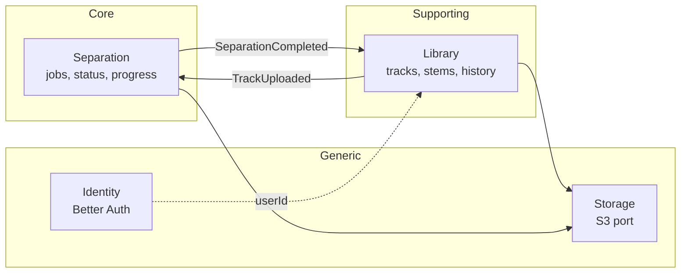
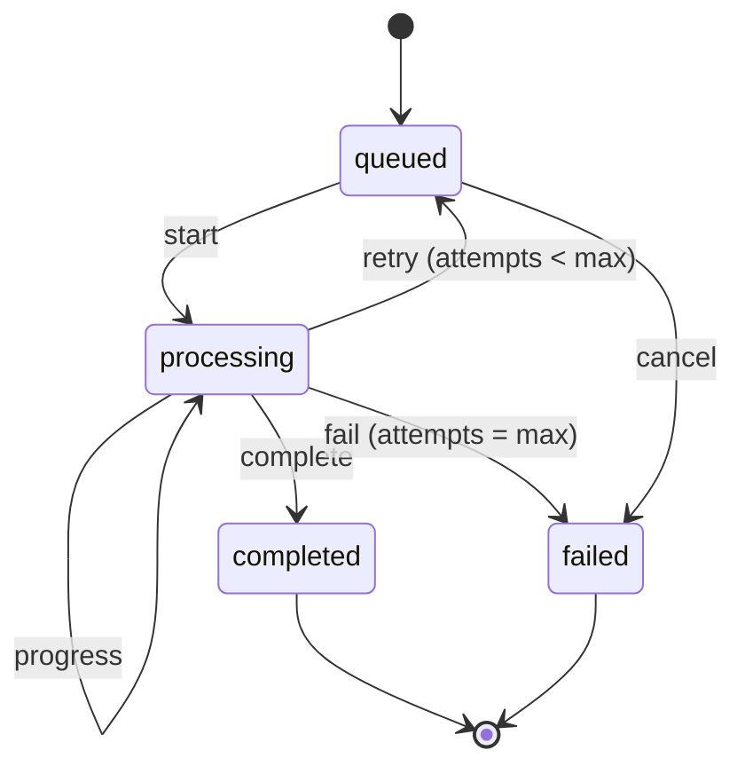

# 06 — Domain (DDD)

## Ubiquitous language

| Term | Meaning |
|------|---------|
| **Track** | A song uploaded by the user. It has an original file and, once separated, stems. |
| **Source media** | The original file (audio or video) exactly as the user uploaded it. |
| **Stem** | One instrument's isolated track: `vocals`, `drums`, `bass`, `guitar`, `piano`, `other`. |
| **Separation job** | One run of a track's separation with a given model. |
| **Separator** | The engine that splits stems (Demucs today). |
| **Stage** | Phase of a running job: `downloading`, `normalizing`, `separating`, `uploading`. |
| **Mix** | Mixer state in the browser: volume, mute and solo per stem. |
| **Demo song** | A pre-separated, licensed song every new user receives ([ADR 0026](adr/0026-demo-song-and-cleanup.md)). |

This vocabulary is used the same way in code, docs and conversations with the client.

## Bounded contexts

| Context | Type | Lives in | Modeling |
|---------|------|----------|----------|
| Separation | Core | `apps/api/modules/separation` + `services/worker` | Full tactical DDD |
| Library | Supporting | `apps/api/modules/library` | Light tactical DDD |
| Identity | Generic | `apps/api/modules/identity` | Direct Better Auth integration |
| Storage | Infrastructure | `ObjectStorage` port | No domain |

Contexts do not import each other's code. They talk through domain events (inside the API) or versioned messages from `packages/contracts` (API ↔ worker).

## Aggregates

### Library · `Track`

- Root: `Track` (`TrackId`, `ownerId`, `title`, `SourceMedia`, `Duration`, `status`, `credit?`).
- Contains: `Stem[]` (`StemName`, `ObjectKey`, `sizeBytes`, `silent`, preview and peaks keys).
- Invariants:
  - A track has at most one stem per `StemName`.
  - Stems are attached only while the track is `separating`.
  - `Duration` ≤ the configured limit (10 min).
  - Only its owner can see or change it; for anyone else it does not exist ([ADR 0025](adr/0025-sessions-and-ownership.md)).

### Separation · `SeparationJob`

- Root: `SeparationJob` (`JobId`, `TrackId`, `model`, `status`, `Progress`, `stage`, `attempts`, `failure?`).
- State machine:

- Invariants:
  - `Progress` only grows within one attempt.
  - `completed` requires the model's full set of stems.
  - Invalid transitions return `Result.err(InvalidTransition)`.
  - A job belongs to whoever owns its track.

## Value objects

`TrackId`, `JobId`, `StemName`, `Duration`, `MediaType`, `ObjectKey`, `Progress`, `SeparationModel`. Immutable; they validate on creation (a factory that returns a `Result`).

## Domain events

| Event | Emitter | Consumers |
|-------|---------|-----------|
| `TrackUploaded` | Library | Separation (creates the job) |
| `SeparationRequested` | Separation | Outbox → `separation` queue → worker |
| `SeparationProgressed` | Worker | Separation (updates the job) → SSE |
| `SeparationCompleted` | Worker | Separation, Library (attaches stems) |
| `SeparationFailed` | Worker | Separation, Library |

Events inside the API go through the outbox ([ADR 0014](adr/0014-transactional-outbox.md)). Messages between processes use the versioned contracts ([ADR 0016](adr/0016-contracts-zod-json-schema-pydantic.md)).

## The worker as part of a context

The worker belongs to the Separation context, but its model is independent from the API's: it only knows `SeparationTask` (what to split, where to put it) and `Stem`. It knows nothing about tracks, users or job states.
