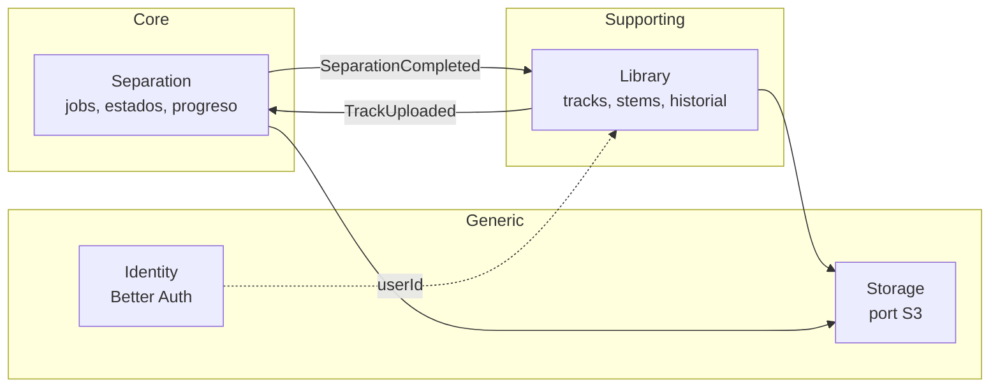
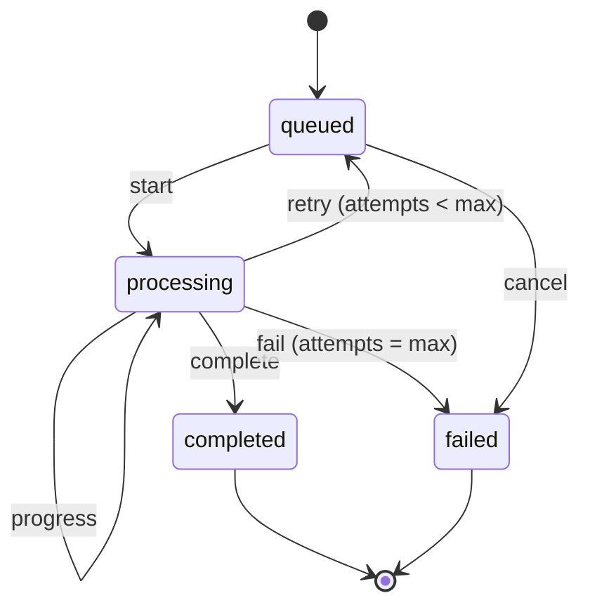

# 06 — Dominio (DDD)

## Lenguaje ubicuo

| Término | Significado |
|---------|-------------|
| **Track** | Canción subida por el usuario. Tiene un archivo original y, tras separarse, stems. |
| **Source media** | Archivo original (audio o video) tal como lo subió el usuario. |
| **Stem** | Pista aislada de un instrumento: `vocals`, `drums`, `bass`, `guitar`, `piano`, `other`. |
| **Separation job** | Ejecución de la separación de un track con un modelo concreto. |
| **Separator** | Motor que separa stems (hoy Demucs). |
| **Stage** | Fase de un job en curso: `downloading`, `normalizing`, `separating`, `uploading`. |
| **Mix** | Estado del mixer en el navegador: volumen, mute y solo por stem. |

Este vocabulario se usa igual en código, docs y conversación con el cliente.

## Bounded contexts

| Contexto | Tipo | Dónde vive | Modelado |
|----------|------|------------|----------|
| Separation | Core | `apps/api/modules/separation` + `services/worker` | DDD táctico completo |
| Library | Supporting | `apps/api/modules/library` | DDD táctico ligero |
| Identity | Generic | `apps/api/modules/identity` | Integración directa con Better Auth |
| Storage | Infraestructura | port `ObjectStorage` | Sin dominio |

Los contextos no importan código entre sí. Se comunican por eventos de dominio (dentro de la API) o por mensajes versionados de `packages/contracts` (API ↔ worker).

## Agregados

### Library · `Track`

- Raíz: `Track` (`TrackId`, `title`, `SourceMedia`, `Duration`, `status`, `ownerId?`).
- Contiene: `Stem[]` (`StemName`, `ObjectKey`, `sizeBytes`).
- Invariantes:
  - Un track tiene como máximo un stem por `StemName`.
  - Los stems solo se adjuntan cuando el track está en estado `separating`.
  - `Duration` ≤ límite configurado (10 min).

### Separation · `SeparationJob`

- Raíz: `SeparationJob` (`JobId`, `TrackId`, `model`, `status`, `Progress`, `stage`, `attempts`, `failure?`).
- Máquina de estados:

- Invariantes:
  - `Progress` solo crece dentro de un mismo intento.
  - `completed` exige el conjunto completo de stems del modelo.
  - Las transiciones inválidas devuelven `Result.err(InvalidTransition)`.

## Value objects

`TrackId`, `JobId`, `StemName`, `Duration`, `MediaType`, `ObjectKey`, `Progress`, `SeparationModel`. Inmutables, validan en su constructor (fábrica que devuelve `Result`).

## Eventos de dominio

| Evento | Emisor | Consumidores |
|--------|--------|--------------|
| `TrackUploaded` | Library | Separation (crea job) |
| `SeparationRequested` | Separation | Outbox → cola `separation` → worker |
| `SeparationProgressed` | Worker | Separation (actualiza job) → SSE |
| `SeparationCompleted` | Worker | Separation, Library (adjunta stems) |
| `SeparationFailed` | Worker | Separation, Library |

Los eventos internos de la API pasan por la outbox ([ADR 0014](adr/0014-transactional-outbox.md)). Los mensajes entre procesos usan los contratos versionados ([ADR 0016](adr/0016-contratos-zod-json-schema-pydantic.md)).

## Worker como contexto

El worker pertenece al contexto Separation, pero su modelo es independiente del de la API: solo conoce `SeparationTask` (qué separar, dónde dejarlo) y `Stem`. No conoce tracks, usuarios ni estados de job.
